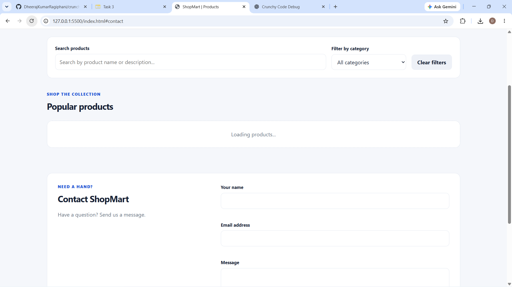
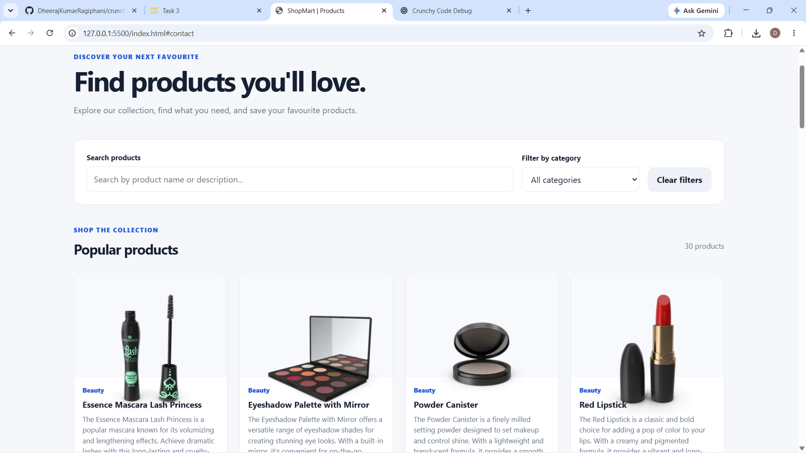
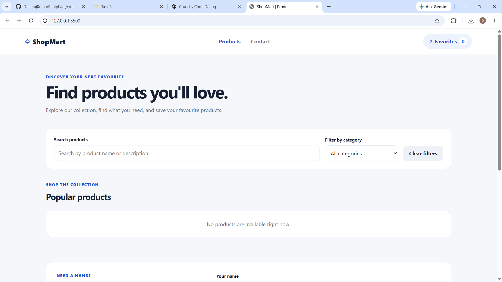
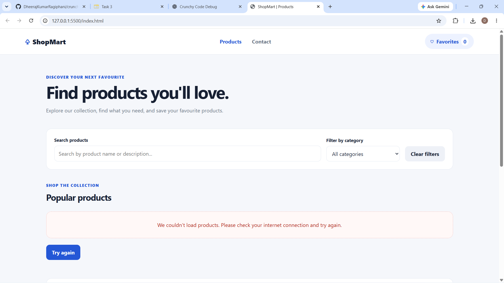

# ShopMart - Task 3 interface state evidence

This file documents the four required interface states.

**Important:** Capture the screenshots from your own running project in Chrome. Save the image files in this same `docs` folder using the filenames shown below.

## 1. Loading state

1. Open the website in Chrome.
2. Press `F12` to open Developer Tools.
3. Select the **Network** tab.
4. Change network throttling from `No throttling` to **Slow 3G**.
5. Reload the page.
6. Capture the page while the `Loading products...` message is visible.

Save as `loading.png`.



## 2. Success state

1. Set network throttling back to `No throttling`.
2. Reload the page.
3. Wait until product cards appear.
4. Capture the product listing.

Save as `success.png`.



## 3. Empty state

Test the empty state with a controlled API response containing an empty `products` array, for example:

```json
{
    "products": []
}
```

Use a local mock/DevTools response override for testing. The application should show the no-products message.

Save as `empty.png`.



## 4. Error state

1. Open Developer Tools and select the Network tab.
2. Use request blocking to block `dummyjson.com`, or disconnect the network.
3. Reload the page.
4. Confirm that the error message and `Try again` button appear.
5. Capture the page.

Save as `error.png`.



---

## Final evidence check

The `docs` folder should contain:

```text
docs/
├── STATES.md
├── loading.png
├── success.png
├── empty.png
└── error.png
```

Do not leave the Markdown image links pointing to files that you have not captured yet.
